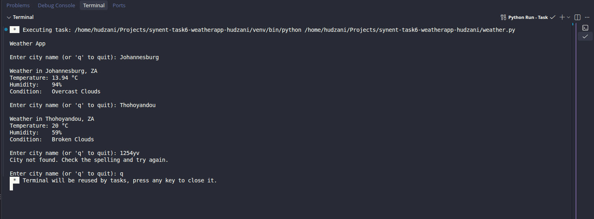

 Weather App(API Integration)

     Synent Technologies Python Internship, task 6.

    A command line app that fatches real time weather for any city using the OpenWeather API.

**Features**

    -Input a city name
     -Display temperature, humidity and weather condition 
     -Handles invalid cities, network errors and invalid API keys
     -API key is loaded from a '.env' file and never hard coded

**Setup**

    1.Install the liabraries: 
    -pip install requests python-dotenv
    2.Get a free API key from openweathermap.org.

    3.Copy 'Weather_App/.env.example to 'Weather_App/.env' and add your key:

        OPENWEATHER_API_KEY=your_key_here

**How to run**

    python weather.py

**Example output**

    Weather App

    Enter city name(or 'q' to quit): Johannesburg

    weather in Johannesburg, ZA
    Temperature: 21.02 °C
    Humidity:    59%
    Condition:   Few Clouds
    
**Security note**

    The API key is loaded from a '.env' file, which is listed in '.gitignore' so it is never uploaded to Github.

**Methodology**

    1. Load the API from a '.env' file using 'python-dotenv', so the key is never written in the code
    2. Check that the key exits. If it is missing,show a message and stop
    3. Ask the user for a city name in a loop. Empty input is rejected, and 'q' quits the program.
    4. Send a GET request to the OpenWeather API using 'request', with a 10 second timeout and 'try/except' to handle network errors.
    5. Check the response status code: 200 means success, 404 means the city was not found, 401 means the API key is invalid.
    6. On success, convert the JSON response into python dictionary and read the cityname, country, tempearature, humidity and weather decription.
    7. Display the weather in the terminal, then ask for another city.

**Screenshots**

**Author**
Hudzani